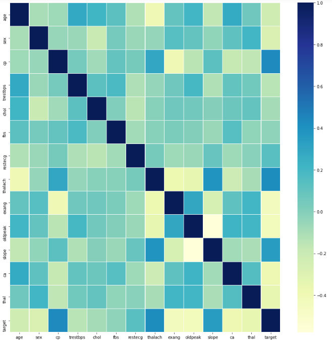
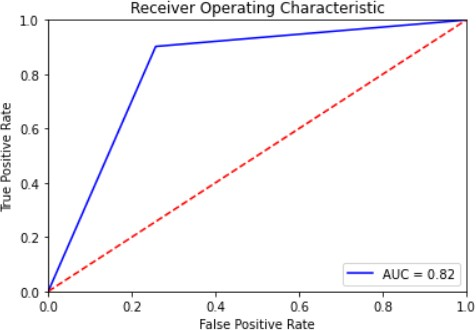
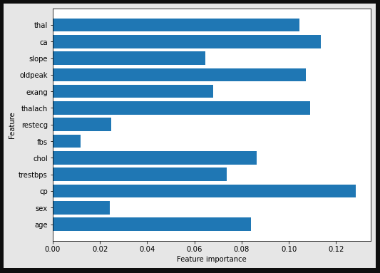
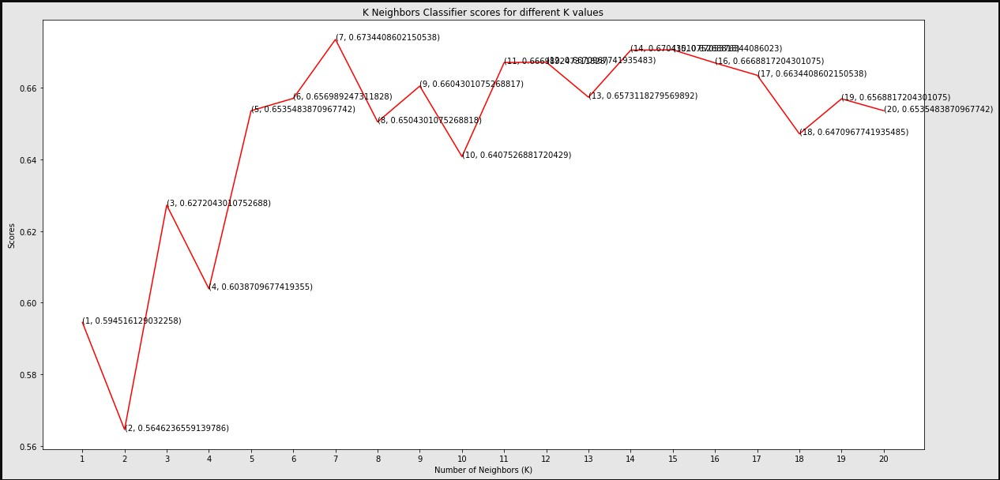
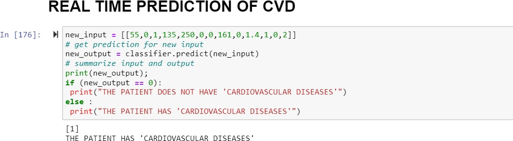
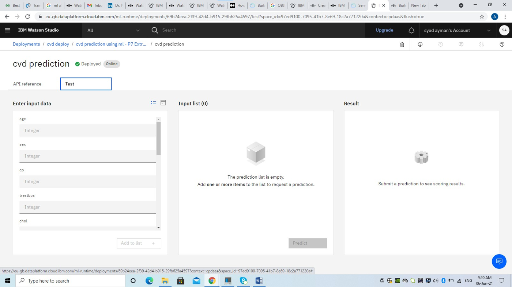
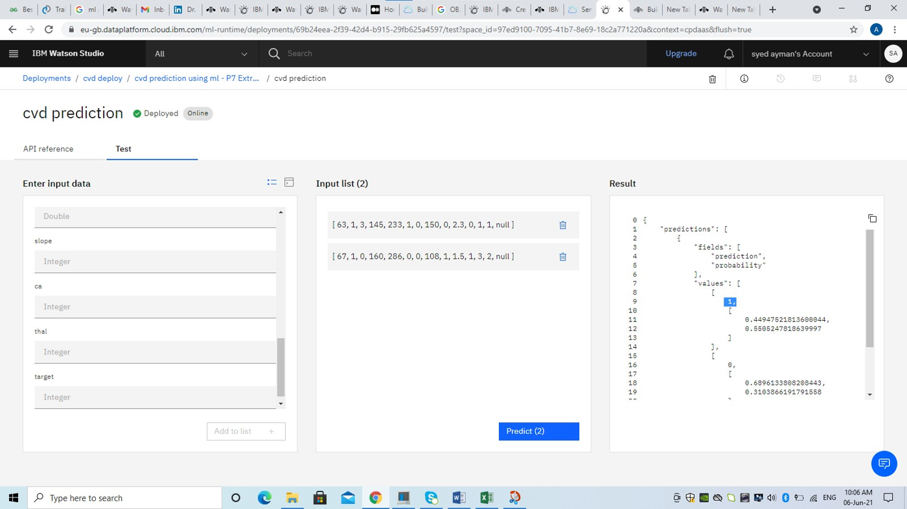

# Prediction of Cardiovascular Diseases using Machine Learning Algorithms

My Bachelor of Engineering final-year project. It compares five machine learning classifiers (K-Nearest Neighbours, Logistic Regression, Decision Tree, Random Forest and Support Vector Machine) for predicting heart disease from 13 routine clinical measurements, uses the best model to predict for new patients in real time, and deploys the model on IBM Cloud with Watson Studio so predictions can be made through a web interface.

BE in Electronics and Communication Engineering, Muffakham Jah College of Engineering and Technology, Hyderabad (affiliated to Osmania University). Team project with Shaik Sahera Begum and Mohammed Asif Ahmed. Project guide: Dr. M. A. Raheem. Carried out from August 2021 and completed in April 2022.

## Project at a glance

| | |
|---|---|
| **Problem** | Heart disease causes about 17.9 million deaths a year (WHO). Early screening from routine measurements can flag patients who need further tests |
| **Dataset** | Kaggle heart disease dataset (UCI heart disease data): 303 patients, 13 clinical attributes, binary `target` (165 with disease, 138 without), no missing values |
| **Models** | K-Nearest Neighbours, Logistic Regression, Decision Tree, Random Forest, Support Vector Machine |
| **Evaluation** | Stratified train/test split (227/76 rows), 10-fold cross-validation for KNN, accuracy, ROC curve and AUC, feature importance |
| **Best model** | Random Forest: 83.9% accuracy, AUC 0.82 |
| **Deployment** | IBM Cloud, Watson Studio and Watson Machine Learning (AutoAI), tested through the deployment's prediction window |
| **Tools** | Python (pandas, NumPy, Matplotlib, Seaborn, SciPy, statsmodels, scikit-learn), Jupyter Notebook, IBM Watson Studio, Microsoft Project |
| **Completed** | April 2022 |

## The data

Each row is one patient. The 13 input attributes are:

| Attribute | Meaning |
|---|---|
| `age` | Age in years |
| `sex` | 1 = male, 0 = female |
| `cp` | Chest pain type (0 to 3) |
| `trestbps` | Resting blood pressure (mm Hg) |
| `chol` | Serum cholesterol (mg/dl) |
| `fbs` | Fasting blood sugar above 120 mg/dl (1 = yes) |
| `restecg` | Resting ECG result (0 to 2) |
| `thalach` | Maximum heart rate achieved |
| `exang` | Exercise-induced angina (1 = yes) |
| `oldpeak` | ST depression induced by exercise relative to rest |
| `slope` | Slope of the peak exercise ST segment |
| `ca` | Number of major vessels coloured by fluoroscopy (0 to 4) |
| `thal` | Thalassaemia test result |

The patients are aged 29 to 77, most often 57 to 59. 207 are male and 96 female.

## What I did

```
Dataset ──> Exploratory analysis ──> Train/test split ──> Train 5 classifiers ──> Compare accuracy
                                                                                        │
              IBM Watson Studio deployment <── Real-time prediction <── Random Forest ──┘
```

1. **Exploratory data analysis.** Checked the shape and missing values, counted patients by each attribute, plotted histograms of every column, a correlation heatmap, scatter plots of each attribute against the target and box plots to check for outliers (resting blood pressure has a few high values above 170 mm Hg).
2. **Train/test split.** A stratified split so both sets keep the same share of patients with and without disease, giving 227 training rows and 76 test rows.
3. **Five classifiers, each with some tuning:**
   - **KNN:** 10-fold cross-validation for k = 1 to 20, with k = 7 chosen.
   - **Logistic Regression:** regularisation strength C = 0.01, 1 and 100 compared.
   - **Decision Tree:** an unpruned tree (training accuracy 1.000, test 0.789, so clear overfitting) compared with a tree limited to depth 3.
   - **Random Forest:** 100 trees, 100 trees with depth 3, and 10 trees with the entropy criterion.
   - **SVM:** trained on raw and on MinMax-scaled features, since SVM is sensitive to feature scale.
4. **Real-time prediction.** A new patient's 13 values are entered in order and the Random Forest returns 1 (CVD) or 0 (no CVD).
5. **Cloud deployment.** Created a Watson Machine Learning instance on IBM Cloud, uploaded the dataset as a project asset, built and deployed the model with AutoAI, and tested it from the deployment's prediction window, where values are typed in for each attribute and the result comes back as 1 or 0.

## Results

Accuracy of the five algorithms (Table 7.1 of the thesis):

| Model | Setting | Accuracy |
|---|---|---|
| K-Nearest Neighbours | k = 7, 10-fold cross-validation | 67% |
| Logistic Regression | C = 1 | 82% |
| Decision Tree | max_depth = 3 | 81.6% |
| Support Vector Machine | MinMax-scaled features | 75% |
| **Random Forest** | **10 trees, entropy criterion** | **83.9%** |

Training and test accuracy from the notebook runs printed in Chapter 6:

| Model | Training | Test |
|---|---|---|
| Logistic Regression (C = 1) | 0.859 | 0.829 |
| Logistic Regression (C = 0.01) | 0.780 | 0.724 |
| Decision Tree (no depth limit) | 1.000 | 0.789 |
| Decision Tree (max_depth = 3) | 0.850 | 0.816 |
| Random Forest (100 trees) | 1.000 | 0.829 |
| Random Forest (100 trees, max_depth = 3) | 0.916 | 0.816 |
| Random Forest (10 trees, entropy) | 0.987 | 0.829 |
| SVM (unscaled) | 0.66 | 0.58 |
| SVM (MinMax scaled) | 0.88 | 0.75 |

Note: Table 7.1 gives 83.9% for Random Forest, while the notebook output in Chapter 6 shows a test accuracy of 0.829. Both figures are reported here as they appear in the thesis.

### Key findings

- **Random Forest performed best** and was chosen for real-time prediction and deployment. Its ROC curve on the test set gives an AUC of 0.82.
- **Limiting tree depth reduced overfitting.** The unpruned Decision Tree scored 100% on training data but only 78.9% on test data. Limiting it to depth 3 lowered training accuracy to 85.0% and raised test accuracy to 81.6%.
- **Scaling mattered for SVM.** MinMax scaling raised SVM test accuracy from 58% to 75%.
- **Chest pain type, thalassaemia result and the number of major vessels were the strongest predictors.** In the depth-3 Decision Tree they account for about 0.52, 0.21 and 0.18 of the total feature importance. The Random Forest spreads importance more widely, with `cp`, `ca`, `thalach`, `oldpeak` and `thal` at the top.
- **KNN was weakest (67%).** It was run on unscaled attributes, and like SVM it depends on distances, so large-valued columns such as cholesterol outweigh binary flags such as `sex` or `fbs`.

| Correlation heatmap | Random Forest ROC curve | Random Forest feature importance |
|---|---|---|
|  |  |  |

| KNN accuracy for k = 1 to 20 | Real-time prediction |
|---|---|
|  |  |

### IBM Watson Studio deployment

| Deployment space | Prediction test results |
|---|---|
|  |  |

All figures are in [`images/`](images). They are taken from the thesis.

## Looking back

The project was done in my final year of engineering, before my MSc in Data Analytics. With what I know now, I would change a few things:

- **Scale the features before KNN and fit the scaler only on the training data.** The SVM step fits `MinMaxScaler` separately on the test set; using `scaler.transform(X_test)` avoids leaking test information.
- **Draw the ROC curve from predicted probabilities** (`predict_proba`) rather than 0/1 labels, which gives a full curve instead of one point.
- **Report recall, precision and a confusion matrix alongside accuracy.** For a screening tool, missing a patient with heart disease costs more than a false alarm.
- **Use repeated cross-validation for every model.** With only 76 test rows, one patient changes accuracy by 1.3 percentage points, so a single split is noisy.
- **Check the target labels.** Users of the Kaggle version of this dataset have reported that its `target` coding is reversed compared with the original UCI data.

My [MSc thesis on credit card fraud detection](https://github.com/Samadnoman/credit-card-fraud-detection-ml) applies these points, using PR-AUC, recall, precision and false-positive rate, and choosing thresholds on validation data.

## Repository structure

```
notebooks/
  cardiovascular_disease_prediction.ipynb   Code for EDA, all five models, ROC curve and real-time prediction
docs/
  BE_Thesis_Cardiovascular_Disease_Prediction_ML.docx / .pdf   Full thesis (89 pages)
images/                                     Key figures from the thesis
requirements.txt                            Python packages used
```

**About the notebook:** the original 2022 `.ipynb` file was not kept, so this notebook was rebuilt line by line from the code screenshots in the thesis. The code is the same as what was run. Outputs are not stored, but the results recorded in the thesis are noted under each step. The dataset path is now relative instead of a local Windows path. The `random_state` of the train/test split is cut off in the screenshot, so your results may differ slightly.

**Thesis chapters:** 1 Introduction · 2 Literature review · 3 Materials and methods · 4 Algorithms · 5 Exploratory data analysis · 6 Execution of algorithms · 7 Results and real-time prediction · 8 IBM Cloud deployment · Conclusion · References · Appendices (Gantt chart and project plan in Microsoft Project). Student roll numbers have been removed from the public copy.

## How to run

1. **Download the data.** Get `heart.csv` from Kaggle ([Heart Disease UCI](https://www.kaggle.com/datasets/ronitf/heart-disease-uci)) and save it as `data/heart.csv`. The original data is from the [UCI Machine Learning Repository](https://archive.ics.uci.edu/dataset/45/heart+disease).
2. **Install the packages:** `pip install -r requirements.txt`
3. **Open the notebook:** `jupyter notebook notebooks/cardiovascular_disease_prediction.ipynb`, then run all cells. The run takes well under a minute.

## Data source and licence

- **Heart disease data:** UCI Machine Learning Repository, Heart Disease dataset (Janosi, Steinbrunn, Pfisterer and Detrano, 1989), via the Kaggle version with 303 patients and 14 columns.
- This was a student project and is not a medical diagnostic tool.

My code and documents are released under the [MIT Licence](LICENSE).
